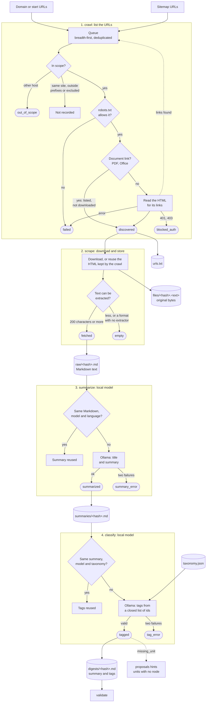

# Documentation

`uzh_data_crawler` is the home of **Taxon**, an agent that maintains the taxonomy of the UZH web in [`taxonomy.json`](../taxonomy.json). Its four skills drive four commands of the `uzh_crawler` package: list the URLs of a site, download them, summarize each document with a local model, and tag each summary with the taxonomy. Installation and a first command are in the [README](../README.md) at the repository root.

| Page | Content |
| --- | --- |
| [Taxon and its skills](agent.md) | What Taxon does, how to call it, how taxonomy proposals work |
| [Command line](cli.md) | Commands, options, progress output, exit codes |
| [Scope](scope.md) | Hosts, path prefixes, sitemaps, exclusions, what is downloaded and extracted |
| [Resume and cache](resume-and-cache.md) | Resuming a run, HTTP cache, when a model call is skipped |
| [Outputs](outputs.md) | `crawl.json`, `urls.txt`, `files/`, `raw/`, `summaries/`, `digests/`, statuses, `validate` |
| [Tags](tags.md) | Taxonomy contract, the two model calls, tag validation |
| [Original specification](SPEC-crawl-summary-tags-pipeline.md) | The v1 brief the tool was first built from. The pages above describe what the code does today |

## How a run works

A run is one directory, `runs/<name>/`, that four stages fill in turn. Each stage reads what the previous one wrote and records its progress in `crawl.json`, so any stage can be run alone, on a few URLs, or again later.

| Stage | Command | Reads | Writes |
| --- | --- | --- | --- |
| 1. Crawl | `crawl` | The site: sitemaps and links | `crawl.json`, `urls.txt` |
| 2. Scrape | `scrape` | The listed URLs | `files/`, `raw/` |
| 3. Summarize | `summarize` | `raw/` | `summaries/` |
| 4. Classify | `classify` | `summaries/`, `taxonomy.json` | `digests/` |

`run` chains the four. `validate` re-checks a finished run without fetching or calling the model.

The diagram follows one URL through the four stages. Rounded boxes are the page statuses written to `crawl.json`; cylinders are files.



The rules behind each decision are in [Scope](scope.md) for crawl and scrape, and in [Resume and cache](resume-and-cache.md) and [Tags](tags.md) for the two model stages.

## Code layout

The package has one sub-package per stage.

```text
CLAUDE.md                      Taxon, the agent: loaded when the project is opened
.claude/
  skills/uzh-*/SKILL.md        its four skills
  agents/taxon.md              Taxon as a subagent, for delegated tasks
src/uzh_crawler/
  cli.py              argument parsing, RunConfig construction, validate and proposals commands
  config.py           RunConfig, user agent, which command owns which config key
  pipeline.py         opens the run, chains the stages, picks the pages each one handles, exit code
  progress.py         progress lines with elapsed and remaining time
  scope.py            host and section rules (Scope), prefixes, exclusions, dedupe key
  sections.py         the eight --study-sections URLs and their prefixes
  urls.py             URL normalization, uzh.ch host check
  text.py             Markdown normalization and content hash
  taxonomy.py         loads taxonomy.json, validates tag ids and cardinalities
  proposals.py        missing-unit hints, proposal checks, accepting a proposal
  validate.py         checks crawl.json, summaries and digests
  crawl/              stage 1
    discover.py       queue, workers, link following, urls.txt
    sitemap.py        sitemap discovery and parsing
    robots.py         robots.txt cache
    limiter.py        per-host rate limit
  scrape/             stage 2
    scraper.py        download or reuse, store the original, extract, set the status
    fetch.py          one HTTP exchange: conditional request, size limit, content type
    extract.py        HTML and PDF to Markdown, link extraction
    js_fallback.py    optional Playwright render
  summarize/          stage 3
    summarizer.py     the summary call, the stage loop, the summary file format
    prompt.py         system and user prompts, input truncation
  classify/           stage 4
    classifier.py     the classification call and the stage loop
    schema.py         Pydantic model built from the taxonomy ids
    prompt.py         system prompt with the list of ids, user prompt
    render.py         writes and parses a digest file
  llm/
    ollama.py         the Ollama chat call shared by stages 3 and 4
  store/
    crawl_json.py     the manifest: pages, statuses, counters, version 1 upgrade
    cache_sqlite.py   what each summary and classification was made from
    paths.py          file names inside a run directory
```
