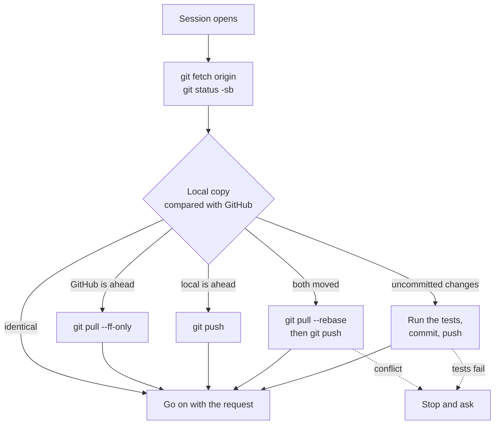
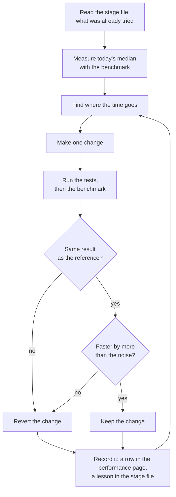
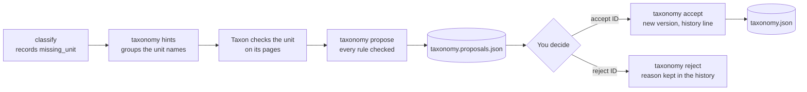

# Taxon and its skills

Opening this repository in Claude Code gives you **Taxon**, the agent of this project: [`CLAUDE.md`](../CLAUDE.md) at the root is loaded at the start of every session and tells Claude its name and its mission, which is to keep [`taxonomy.json`](../taxonomy.json) true to the UZH web it describes. Taxon has six skills. Four are the instructions for one stage each, and each stage is one command of the `uzh_crawler` package. `taxon-gate` keeps the taxonomy itself: it reads, checks, changes and exports it through the `taxonomy` command. `uzh-optimize` is about the code: how to make a stage faster.

| File | Role |
| --- | --- |
| [`CLAUDE.md`](../CLAUDE.md) | Taxon: name, mission, how the stages fit together, how to propose taxonomy changes. Loaded automatically |
| [`AGENTS.md`](../AGENTS.md) | The same instructions for Codex: it tells Codex to load and follow `CLAUDE.md`, which wins on any conflict |
| [`.claude/skills/uzh-crawl/SKILL.md`](../.claude/skills/uzh-crawl/SKILL.md) | Listing the URLs of a domain |
| [`.claude/skills/uzh-scrape/SKILL.md`](../.claude/skills/uzh-scrape/SKILL.md) | Downloading and storing documents |
| [`.claude/skills/uzh-summarize/SKILL.md`](../.claude/skills/uzh-summarize/SKILL.md) | Summarizing with the local model |
| [`.claude/skills/uzh-classify/SKILL.md`](../.claude/skills/uzh-classify/SKILL.md) | Tagging summaries with the taxonomy |
| [`.claude/skills/taxon-gate/SKILL.md`](../.claude/skills/taxon-gate/SKILL.md) | Reading, checking, changing and exporting the taxonomy |
| [`.claude/skills/uzh-optimize/`](../.claude/skills/uzh-optimize/SKILL.md) | Making a stage faster: the method, and what was already tried for `crawl`, `scrape` and `summarize` |
| [`.claude/agents/taxon.md`](../.claude/agents/taxon.md) | Taxon as a subagent, for a task delegated to the background. It follows `CLAUDE.md` |

## Who does what

Four actors are involved, and the split between them is deliberate.

- **The Python package** does everything that must be exact and repeatable: HTTP, scope rules, file storage, hashes, caches, the closed JSON schema, validation.
- **The local model** (Ollama) reads documents. It writes each summary, and it picks tags from the list of ids it is given. It never sees the taxonomy file itself and cannot store a tag outside it.
- **Taxon** (Claude) decides what to run and in which order, reads the results, reports, and proposes taxonomy changes through the `taxonomy` command. The command writes the taxonomy files; Taxon never edits them by hand.
- **You** decide which proposals enter the taxonomy. Taxon accepts a proposal only when you name its id.

## Two standing duties

Whatever it is asked to do, Taxon keeps two things true. Both are rules in [`CLAUDE.md`](../CLAUDE.md).

**The documentation describes Taxon as it is.** Whenever Taxon changes how the project behaves, it updates the pages and diagrams that describe that behaviour in the same piece of work, and keeps them simple, built on examples, and visual.

**Taxon's state is on GitHub.** The state is everything git tracks: `CLAUDE.md`, the skills, the code, the tests, the documentation and the taxonomy. Crawl data under `runs/` is not part of it.

The first thing Taxon does in a session is compare the local copy with GitHub and align them. The diagram reads from top to bottom: one check, then one action per situation.



During the session, each finished piece of work ends the same way: tests pass, documentation updated, commit, push. Taxon stops and asks instead of pushing when a pull hits a conflict, when tests fail on changes it did not make, or when GitHub refuses the push. It never rewrites history on GitHub.

## Using Taxon

Open Claude Code in the repository and ask. There is nothing to select: the session is Taxon.

```text
List all the URLs of oec.uzh.ch.
Survey phil.uzh.ch end to end.
Which units of runs/phil have no node in the taxonomy?
Scrape https://www.phil.uzh.ch/de/studium.html and summarize it in English.
```

For a long survey that should not occupy the session, ask for it to be delegated to the `taxon` subagent.

## The four stage skills

| Skill | Input | Output | Needs |
| --- | --- | --- | --- |
| `uzh-crawl` | A domain or a section URL | `urls.txt`, the list of all URLs, and `crawl.json` | Network |
| `uzh-scrape` | URLs, or the list of a crawl | `files/` (originals) and `raw/` (Markdown text) | Network |
| `uzh-summarize` | Scraped documents | `summaries/` | Ollama |
| `uzh-classify` | Summaries and `taxonomy.json` | `digests/` (summary plus tags) | Ollama |

Each stage only needs the output of the one before it, so they can be run on different days, on a subset of URLs, or redone alone. Changing the taxonomy, for instance, only redoes `classify`.

Classification reads the summary, not the document. The summary stage is therefore prompted to keep what classification needs: the publishing unit, the audience, the kind of document and the study level. A summary that omits one of these gives a weaker tag on that axis; this is the price of keeping the two stages separate.

## The optimization skill

`uzh-optimize` is not a stage. It is what Taxon loads when the request is "make this faster", and it serves as a memory: `crawl` and `scrape` were each tuned in twenty measured attempts, `summarize` in fifty, and most attempts failed. Without a record, the next session would try the same dead ends again.

A skill is a folder, and Claude reads its files only when it needs them. This skill uses that to separate what is general from what is specific:

| File | Holds | Read |
| --- | --- | --- |
| [`SKILL.md`](../.claude/skills/uzh-optimize/SKILL.md) | The method, and the lessons that held for both stages | Every time the skill is loaded |
| [`crawl.md`](../.claude/skills/uzh-optimize/crawl.md) | For `crawl`: what is in the code and why, what failed, the traps, what limits the speed now | Only before work on the crawl |
| [`scrape.md`](../.claude/skills/uzh-optimize/scrape.md) | The same for `scrape` | Only before work on the scrape |

A stage skill such as `uzh-scrape` says how to *run* the stage and stays short. It points to `uzh-optimize` in one sentence, so a session that only scrapes a site never loads the history of the optimization.

The method is a loop. Read the diagram from the top: one idea goes round once, and it is written down whether it is kept or not.



The two records have different readers. The pages [Crawl performance](crawl-performance.md) and [Scrape performance](scrape-performance.md) tell the whole story to a person, with every measurement. The stage files of the skill are the short version Taxon acts on: do this, do not retry that, watch out for this.

For example, asking "can the scrape read PDF files faster?" makes Taxon open `scrape.md`, where it finds that three other PDF readers were already measured and lost, and why, before it writes any code.

## The taxonomy skill

`taxon-gate` is how Taxon keeps the taxonomy. Its leading idea is a **gate**: the `taxonomy` command is the only way to read or change [`taxonomy.json`](../taxonomy.json), so that every change is checked against the rules, versioned, and recorded with its reason. The rules, their sources and every command are in [Taxonomy management](taxonomy.md).

The skeleton has no node for most institutes, departments and services. When the classification model has to fall back to a broader `organisation` node, it writes the unit's name, as free text, in the page's `missing_unit`. That field is the bridge from a crawl to the taxonomy. The diagram reads from left to right: Taxon prepares, the command checks, you decide.



1. `taxonomy hints --out runs/phil` lists each unit name with its number of pages, the node they fell back to, example URLs, and any node that already has that name.
2. Taxon confirms on the unit's pages that it is a real unit, finds its official names and its parent, and submits a proposal with `taxonomy propose`. The command refuses a proposal that breaks a rule and says which.
3. Taxon shows you the pending proposals as a table. You name the ones to accept or reject.
4. `taxonomy accept ID…` applies them, raises the version and writes the history. The next `classify` tags every page again; the summaries are reused.

Proposals are not only new nodes. A node can also get new labels or alternative labels (`update`), a new parent (`move`), or be retired with the nodes that replace it (`deprecate`). A retired node stays in the file, so that old tags keep their meaning.

The same command reads the taxonomy (`taxonomy tree`, `show`, `find`) and exports it as CSV, JSON, Markdown or SKOS Turtle (`taxonomy export`).
