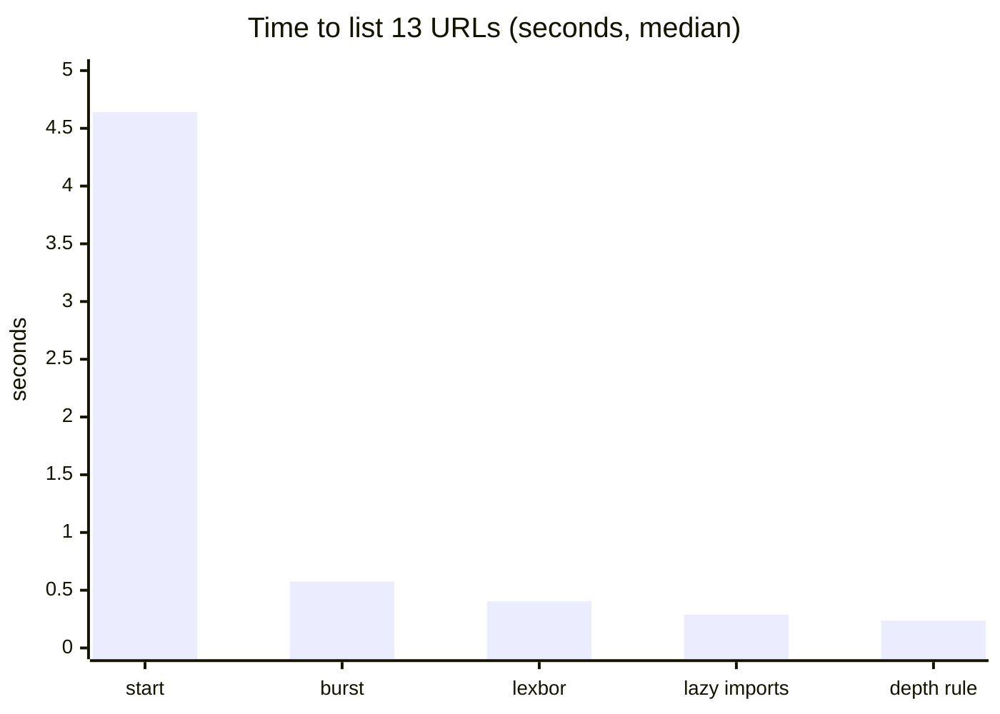
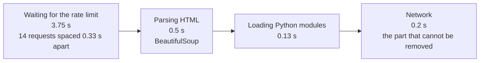

# Crawl performance

This page explains how fast `crawl` lists URLs, how that speed is measured, and what was tried to improve it. Read it before changing the crawl code: it tells you which ideas already paid off, which did not, and how to check a new one.

## The test

The benchmark asks one question: **how long does it take to list about ten URLs?**

The task is fixed. It lists the study section of `df.uzh.ch`, one link deep:

```bash
python -m uzh_crawler crawl www.df.uzh.ch/en/studies.html \
  --include-prefix df.uzh.ch /en/studies.html \
  --include-prefix df.uzh.ch /en/studies \
  --no-sitemap --max-depth 1 --max-pages 0 --out <empty directory>
```

The result is 13 URLs: the section index and the 12 pages it links to. The benchmark runs this command against the real site several times, each time in an empty directory, and reports the **median** wall-clock time of the whole process, Python start-up included.

```bash
.venv/bin/python benchmarks/crawl_speed.py                  # 7 runs, prints the median
.venv/bin/python benchmarks/crawl_speed.py --task sitemap   # second task, see below
.venv/bin/python benchmarks/crawl_speed.py --profile        # where one run spends its time
.venv/bin/python benchmarks/crawl_speed.py --command ./other-program   # measure another implementation
```

Two rules keep the measurement honest:

- **Same result.** A run only counts when it lists exactly the URLs in `benchmarks/expected_links.txt`. A change cannot get faster by finding less.
- **Real conditions.** The crawl still obeys `robots.txt` and still identifies itself. Nothing is mocked.

A second task, `--task sitemap`, lists the whole of `df.uzh.ch` from its sitemaps (979 URLs). It measures the default first step of a crawl, which the headline task skips.

## The result

Twenty ideas were tried, one at a time. Each was measured and then kept or dropped. The chart shows the headline task after each change that was kept.



| Measure | Before | After | Gain |
| --- | --- | --- | --- |
| 13 URLs by links (headline task) | 4.64 s | 0.24 s | about 20 times faster |
| 979 URLs from sitemaps | 1.57 s | 0.32 s | 5 times faster |
| 98 URLs, 60 pages read, sitemaps and links | 34.8 s | 14.9 s | 2.3 times faster |

The third line is the one to remember for real work. A large crawl is paced by the politeness rate, 3 requests per second per host by default, and no optimization changes that. The gains on a large crawl come from the first burst and from requests that are no longer wasted.

## Where the time went

Before any change, a profile of the headline task split its 4.64 seconds into four parts. The diagram lists them from the largest to the one that cannot be removed.



Almost all of it was waiting. The old limiter spaced every request by a third of a second, including the first ones, so 14 requests took over four seconds whatever the server did.

## The twenty iterations

Times are medians on the headline task unless the row says otherwise. Each idea is compared with the code as it stood just before.

| # | Idea | Measured | Verdict |
| --- | --- | --- | --- |
| 1 | Rate limiter as a token bucket: a burst of 20 requests at once, then the steady rate | 4.64 s → 0.575 s | **Kept** |
| 2 | Extract links with the standard library `HTMLParser` instead of BeautifulSoup | Parsing 13 pages: 127 ms → 41 ms | Superseded by 5 |
| 3 | Extract links with `lxml` | 17 ms | Dropped: slower than 5, heavier to install |
| 4 | Extract links with regular expressions | 8.7 ms | Dropped: as fast as 5 but not a real HTML parser |
| 5 | Extract links with the lexbor HTML5 parser (`selectolax`) | 8.6 ms; 0.575 s → 0.404 s | **Kept** |
| 6 | Import each stage only when it runs | Imports: 131 ms → 54 ms; 0.404 s → 0.289 s | **Kept** |
| 7 | Rewrite the crawl in Go | 0.199 s against 0.308 s for Python in the same session | Not adopted, see below |
| 8 | `uvloop` event loop | 0.325 s against 0.294 s | Dropped: no gain |
| 9 | HTTP/1.1 instead of HTTP/2 | 0.310 s against 0.294 s | Dropped: slower |
| 10 | Do not keep the HTML on disk | 0.293 s against 0.294 s | Dropped: no gain, and `scrape` would download every page again |
| 11 | Cache URL normalization | 0.296 s against 0.294 s | Dropped: no gain |
| 12 | A libcurl-based HTTP client instead of `httpx` | 0.279 s against 0.273 s on the same requests | Dropped: no gain, slower to import |
| 13 | Brotli or Zstandard compression | The server only answers with gzip | Dropped: nothing to gain |
| 14 | Do not read a page at the depth limit: its links would not be followed | 0.289 s → 0.225 s | **Kept** |
| 15 | Fetch sitemaps in parallel waves | Sitemap task: 1.57 s → 1.52 s | **Kept** |
| 16 | Fetch `robots.txt` once per host, and share it with sitemap discovery | Sitemap task: 1.52 s → 0.32 s | **Kept**, and a bug fixed |
| 17 | Python isolated mode (`-I`) | 0.220 s against 0.230 s | Dropped: within the noise |
| 18 | Console script instead of `python -m` | 0.235 s against 0.230 s | Dropped: no gain |
| 19 | Do not rewrite `crawl.json` a second time at the start of a crawl | Sitemap task: no measurable change | Kept as a cleanup |
| 20 | Encode `crawl.json` with `orjson` | 51,200 pages: 305 ms → 24 ms per save, identical bytes | **Kept**: matters for large runs |

Run-to-run noise on the headline task is about 0.02 s, so a difference smaller than that is not a result.

## What the kept changes do

**Token bucket (1).** Each host has a bucket of 20 tokens. A request takes one token; an empty bucket makes the request wait. Tokens come back at the steady rate. A short crawl therefore sends its first 20 requests at once, and a long crawl still averages 3 requests per second. `--burst` sets the size of the bucket and `--rate-limit` the refill rate.

**lexbor parser (5).** A crawl reads pages only for their links. lexbor is an HTML5 parser written in C; it reads a page about fifteen times faster than BeautifulSoup and returned the same links on every benchmark page. `scrape` now uses the same parser to find the text of a page ([Scrape performance](scrape-performance.md)).

**Lazy imports (6).** `crawl` no longer loads the Markdown, PDF and model libraries that only the later stages use.

**Depth rule (14).** With `--max-depth N`, a page found at depth N is listed without being requested, because its links would not be followed. Whether that page still exists is checked later, when `scrape` downloads it. This is the same treatment a linked PDF already gets.

**`robots.txt` once (16).** When many workers started on the same host together, each one downloaded `robots.txt`. Twenty copies used up the whole burst, and the first real pages then waited for the rate limit. Now the first worker downloads it and the others wait for that answer. Sitemap discovery reuses the same copy.

**Faster manifest (20).** `crawl.json` is rewritten every two seconds while a crawl runs. On a run of 50,000 URLs the standard encoder took 0.3 s each time, during which nothing else happened. `orjson` writes the same bytes in 0.02 s.

## Why not Go

The Go version in [`benchmarks/experiments/go-crawl/`](../benchmarks/experiments/go-crawl/main.go) does the benchmark task in 0.20 s. Python does it in 0.24 s after the changes above, and did it in 0.31 s when the two were compared. The difference is the start-up of the Python interpreter and of its HTTP library, about 0.1 s per command, and it does not grow with the size of the crawl.

That experiment covers only what the benchmark needs. A real replacement would have to reimplement the scope rules, URL normalization, `robots.txt`, sitemaps, the manifest and resuming, and keep them identical to the Python ones that `scrape` relies on. A tenth of a second per command does not pay for two implementations.

## What limits the speed now

- **The network.** The headline task needs three round trips in sequence: connect, `robots.txt`, the index page. That is about 0.1 s and cannot be done in parallel, because `robots.txt` must be read before the first page is requested.
- **Python start-up.** About 0.1 s to start the interpreter and load the HTTP library.
- **Politeness.** Past the first burst, a host receives 3 requests per second. This is a choice, not a limit of the code: `--rate-limit` raises it, at the cost of more load on the UZH servers.

## Checking a new idea

1. Run `benchmarks/crawl_speed.py` to get today's median before you change anything. The site and the network vary from day to day.
2. Make one change.
3. Run the tests, then the benchmark again, with at least 7 runs.
4. Keep the change only if the median moves by more than the noise and the listed URLs are unchanged. Add a row to the table above either way, so the next person does not repeat a dead end.
