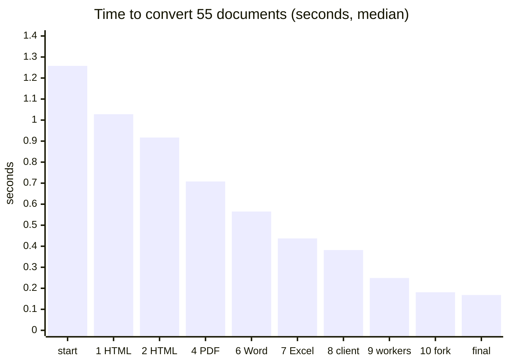
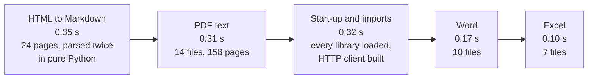
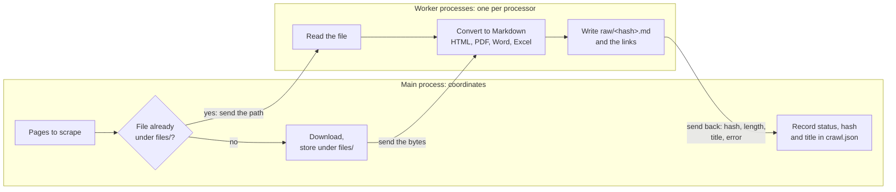

# Scrape performance

This page explains how fast `scrape` turns documents into Markdown, how that speed is measured, and what was tried to improve it. Read it before changing the scrape code: it tells you which ideas already paid off, which did not, and how to check a new one.

## The test

The benchmark asks one question: **how long does it take to turn 55 URLs into Markdown?**

The list is fixed. [`benchmarks/scrape_urls.txt`](../benchmarks/scrape_urls.txt) names 55 documents of UZH sites, in the four formats `scrape` reads:

| Format | Files | Size on disk |
| --- | --- | --- |
| HTML pages | 24 | 2.2 MB |
| PDF files | 14 | 5.3 MB |
| Word files (`.docx`) | 10 | 0.9 MB |
| Excel files (`.xlsx`) | 7 | 0.3 MB |

Two tasks run the real command on that list:

- **`convert`** is the headline task. The 55 files are already on disk, as a crawl leaves them, and `scrape --out <run>` reads them and writes the Markdown. There is no network, so the number is stable to about 0.005 s.
- **`live`** downloads the 55 URLs from the real sites and converts them: `scrape <55 URLs> --out <empty directory>`.

```bash
.venv/bin/python benchmarks/scrape_speed.py                 # convert task, 7 runs, prints the median
.venv/bin/python benchmarks/scrape_speed.py --task live     # with the downloads
.venv/bin/python benchmarks/scrape_speed.py --copies 20     # the same files 20 times: 1,100 documents
.venv/bin/python benchmarks/scrape_speed.py --by-kind       # time of each format, without the command around it
.venv/bin/python benchmarks/scrape_speed.py --profile       # where one run spends its time
```

The time is the wall-clock time of the whole process, Python start-up included. The first run downloads the 55 files once into `benchmarks/.cache/`, which git ignores.

One rule keeps the measurement honest: **same text**. A run only counts when every URL ends `fetched` and its Markdown holds the same words as the reference file in [`benchmarks/expected_scrape/`](../benchmarks/expected_scrape/). The reference is what the code produced before any optimization. "The same words" means that at least 97% of the reference words are found and that at most 5% new words appear; layout may differ, text may not. A change cannot get faster by reading less.

## The result

Twenty ideas were tried, one at a time. Each was measured and then kept or dropped. The chart shows the headline task after each change that was kept and that moved it; the numbers under the bars are the rows of the table further down.



| Measure | Before | After | Gain |
| --- | --- | --- | --- |
| 55 documents already on disk (headline task) | 1.26 s | 0.17 s | 7.5 times faster |
| The same, conversion alone, one processor | 0.94 s | 0.23 s | 4 times faster |
| 1,100 documents already on disk | about 19 s (computed) | 0.65 s | about 29 times faster |
| 55 documents downloaded and converted | 1.93 s | 1.88 s | none, see below |

Two lines need a comment.

The 1,100 documents are the 55 files repeated 20 times. The "before" figure was not run: it is the measured conversion time of the old code, 0.94 s for 55 documents, multiplied by 20. With the new readers and a single process the same run takes 5.5 s; the worker processes bring it to 0.65 s, about 1,700 documents per second.

The `live` task did not get faster, because its time is not spent in the code. One host, `www.oec.uzh.ch`, serves 24 of the 55 URLs. A host receives 20 requests at once and then 3 per second, so the last of these requests leaves after 1.8 s whatever the code does. With a burst of 30 (`--burst 30`) the same task takes 0.64 s. That limit is the politeness rule described in [Scope](scope.md#robots-rate-and-volume), and it stays.

## Where the time went

Before any change, the 1.26 s of the headline task split into five parts. The diagram lists them from the largest to the smallest.



Three things stood out. HTML, the lightest format, cost the most, because each page was parsed twice by a parser written in Python. A quarter of the time was spent before the first document was opened. And the 16 processors of the machine were idle but one: every document waited for the one before it.

## The twenty iterations

Times are medians of the `convert` task unless the row says otherwise. Each idea is compared with the code as it stood just before.

| # | Idea | Measured | Verdict |
| --- | --- | --- | --- |
| 1 | HTML: cut the page down to `main` with the lexbor parser, then convert only that part with `markdownify` | 1.258 s → 1.028 s | **Kept** |
| 2 | HTML: convert with `html-to-markdown`, written in Rust, instead of `markdownify` (`html2text` was also tried) | 24 pages: 68 ms, against 35 ms for `html2text` and 8 ms for Rust; 1.028 s → 0.917 s | **Kept** |
| 3 | HTML: parse each page once for both its links and its text | 0.917 s → 0.914 s | Kept as a cleanup |
| 4 | PDF: read with pdfium instead of PyMuPDF | 14 files: 315 ms → 142 ms; 0.914 s → 0.708 s | **Kept**, with a loss, see below |
| 5 | PDF: two other readers, `pdftotext` as a program and `pdf_oxide` | 627 ms and 344 ms, and both lose words (92% and 96% found) | Dropped: slower and less complete |
| 6 | Word: read the XML of the file directly instead of using `python-docx` | 10 files: 164 ms → 50 ms; 0.708 s → 0.565 s | **Kept** |
| 7 | Excel: read with calamine, written in Rust, instead of `openpyxl` | 7 files: 82 ms → 10 ms; 0.565 s → 0.437 s | **Kept** |
| 8 | Build the HTTP client only when the first request is made; ask `robots.txt` only before a download | 0.437 s → 0.382 s | **Kept** |
| 9 | Convert in worker processes, started from scratch (`spawn`). Tried with 2, 4, 6, 8, 12 and 16 workers | 0.325, 0.269, 0.252, 0.249, 0.255, 0.262 s; 0.382 s → 0.249 s with 8 | **Kept** |
| 10 | Start the workers by `fork` (`forkserver` was also tried) | 0.181 s, against 0.235 s for `forkserver` and 0.249 s for `spawn` | **Kept** where it is safe, see below |
| 11 | Load the parsing libraries in the main process before the fork, so the workers inherit them | 0.184 s against 0.179 s | Dropped: no gain |
| 12 | Hand out the largest files first | 0.187 s against 0.179 s, then 0.177 s against 0.168 s | Dropped: slower, twice |
| 13 | Keep every parsing library out of the main process, which only coordinates | 0.178 s → 0.171 s | **Kept** |
| 14 | Split a long PDF into shares of pages, read by several workers at once | 0.179 s to 0.215 s, against 0.173 s | Dropped: slower |
| 15 | Let each worker read the stored file and write the Markdown itself, instead of passing bytes and text through the main process | 0.171 s → 0.167 s | **Kept**: also bounds memory on large runs |
| 16 | Start the workers empty: each loads only the libraries of the formats it meets | 0.168 s → 0.164 s | **Kept** |
| 17 | PDF again, now that conversion is parallel: PyMuPDF in the workers | 0.247 s against 0.164 s | pdfium confirmed |
| 18 | One worker per processor instead of at most 8, and resolve the path of the run directory once instead of once per file | 1,100 documents: 0.898 s → 0.651 s; 55 documents unchanged | **Kept**: matters for large runs |
| 19 | Send small documents to the workers in batches of 4 to 32 | 1,100 documents: 0.65 s to 0.69 s, against 0.66 s | Dropped: no gain |
| 20 | Stop the workers at the end instead of waiting for them to finish | 0.171 s against 0.168 s | Dropped: no gain |

Run-to-run noise on the `convert` task is about 0.005 s, so a difference smaller than that is not a result.

## What the kept changes do

**One fast reader per format (1, 2, 4, 6, 7).** Each format is now read by a library written in C or Rust, called from Python:

| Format | Before | Now | What the reader is |
| --- | --- | --- | --- |
| HTML | BeautifulSoup and `markdownify` | `selectolax` then `html-to-markdown` | lexbor, an HTML5 parser in C, finds `main` and removes navigation; a Rust library writes the Markdown |
| PDF | PyMuPDF | `pypdfium2` | pdfium, the PDF engine of Chrome |
| Word | `python-docx` | `zipfile` and `lxml` | A `.docx` file is a zip archive of XML. Two parts are read: the text and the style names |
| Excel | `openpyxl` | `python-calamine` | A spreadsheet reader in Rust |

**A client built on demand (8).** Building the HTTP client loads the HTTP library and the TLS certificates, about 60 ms. A scrape that follows a crawl finds its HTML pages on disk and may not send a single request; it no longer pays for a client it does not use. For the same reason `robots.txt` is asked only before a download: a file the crawl stored was already cleared by it.

**Worker processes (9, 10, 13, 15, 16, 18).** Converting a document is work for the processor, and one Python process uses one processor. `scrape` therefore starts worker processes and hands them the documents. The diagram shows who does what: the main process downloads and keeps `crawl.json`; the workers convert and write the Markdown.



Three details make this fast:

- For a file already on disk, only its path travels to the worker, and only a few facts travel back. The document itself never crosses between processes.
- Workers are started by `fork`, which copies the main process in a few milliseconds. A fork is only safe while the main process has a single thread, so the workers are all started first, before any request. When the main process already has threads, as in `run` after the crawl stage, or on Windows, workers are started from scratch instead: 0.07 s slower, same result.
- The main process loads no parsing library. Each worker loads only what the formats it meets require.

Starting workers costs more than converting a few pages, so a scrape of fewer than 8 documents converts in the main process. `--workers N` sets the number of workers; `--workers 1` turns them off.

## What changed in the Markdown

The benchmark guarantees the same words. The layout differs in a few places, and two differences are worth knowing.

- **PDF paragraphs.** PyMuPDF put an empty line between the text blocks of a page. pdfium returns the lines of a page one under the other, with no empty line between paragraphs. Pages are still separated by an empty line. This is the price of reading PDF files twice as fast; the words and their order are the same.
- **Word forms.** The fields of a form (content controls) are skipped, as before, so their placeholder texts such as "Click here to enter text" do not appear. A paragraph that Word numbers or bullets is now written as a list item, whatever its style.

Smaller differences: an Excel cell that holds an error such as `#DIV/0!` is left empty, and inline `svg` drawings are removed from HTML.

## Why not another language

The crawl was rewritten in Go as an experiment ([Crawl performance](crawl-performance.md#why-not-go)). For the scrape, the gain of another language was taken a different way: the four readers *are* written in C and Rust, and Python only passes them the bytes. What remains in Python is start-up and coordination, about 0.06 s per command, and it does not grow with the number of documents. A program written entirely in Rust or Go would save that 0.06 s and would have to reimplement the manifest, the statuses, resuming and the HTTP cache, and keep them identical to the ones the other stages use.

## What limits the speed now

- **The longest document.** With one worker per processor, a small run ends when its slowest file ends. In the benchmark that is a 31-page, 3.3 MB PDF that takes 0.05 s.
- **Python start-up.** About 0.06 s to start the interpreter, load the command and start the workers.
- **The number of processors.** On a large run every processor is busy converting. 1,100 documents take 5.5 s with one worker and 0.65 s with 16.
- **Politeness, when downloading.** Past the first burst a host receives 3 requests per second. A scrape that downloads 1,000 documents from one host takes about five and a half minutes, of which the conversion is one second.

## Checking a new idea

1. Run `benchmarks/scrape_speed.py` to get today's median before you change anything.
2. Make one change.
3. Run the tests, then the benchmark again. For anything about the workers, also run it with `--copies 20`.
4. Keep the change only if the median moves by more than the noise and no run is reported `WRONG`. When a run is `WRONG`, read the lost and added words it prints before you decide: the reference in `benchmarks/expected_scrape/` changes only when the new text is better, and for a reason you can state.
5. Add a row to the table above either way, so the next person does not repeat a dead end.
