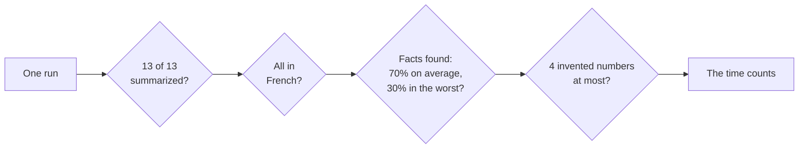
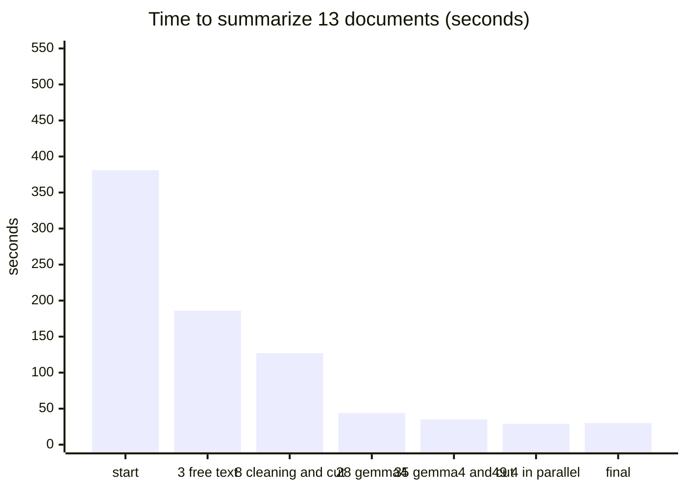

# Summarize performance

This page explains how fast `summarize` turns documents into summaries, how speed and quality are measured, and what was tried. Read it before changing the summary prompt, the model or the model call.

## The test

The benchmark asks one question: **how long does it take to summarize 13 UZH documents, without losing quality?**

The documents are fixed, in [`benchmarks/summarize_corpus/`](../benchmarks/summarize_corpus/), and chosen to be as different as possible: from 691 to 459,000 characters, German and English.

| Kind | Documents |
| --- | --- |
| Web pages | an event, a news list, a study home page, a programme page, exam dates, a FAQ |
| PDF | an organisation chart, a leaflet, a regulation, a reading list, a regulation of 459,000 characters |
| Word and Excel | a registration form, a study planning table |

The reference is in [`benchmarks/summarize_reference/`](../benchmarks/summarize_reference/). A large model, Claude Fable 5.2, read each document and wrote two things: a summary, and a **checklist** of 9 to 12 facts that any good summary of that document must contain. The facts include the four points classification depends on: publishing unit, audience, kind of document and study level.

```bash
.venv/bin/python benchmarks/summarize_speed.py                      # 3 runs, prints the median
.venv/bin/python benchmarks/summarize_speed.py --runs 7             # for a result to report
.venv/bin/python benchmarks/summarize_speed.py -- --model qwen3.5:9b --llm-concurrency 1
.venv/bin/python benchmarks/summarize_speed.py --score-reference    # the references against their checklists
```

The time is the wall-clock time of the real `summarize` command, once the model is loaded. Before each run the model is unloaded, loaded again and warmed up on a short document that is not counted.

**The guard.** A run only counts when all of this holds. The diagram reads from left to right: each box is one condition.



A "found" fact is a pattern match on words, so the guard is a safety net, not a judge. It does not see an invented name or a misread rule. For that, read the summaries (`benchmarks/.cache/summarize-last/`) or have them judged, as below.

## The result

Fifty ideas were measured. Times are on an Apple M3 Max with 48 GB, Ollama 0.40.17.

| | Before | After |
| --- | --- | --- |
| Time, 13 documents (median) | 381 s (3 runs, 356 to 459 s; 505 s the day before) | **30 s** (7 runs, 28 to 32 s) |
| Documents that fail | 3 or 4 of 13 | 0 |
| Facts of the checklist found | 37% | 85% |
| Model | `qwen3.5:9b` | `gemma4:e2b` |

The chart shows the time after each step that was kept; the numbers are rows of the table further down.



### Quality, judged blind

Claude Fable 5.2 also graded three sets of summaries against the documents, without knowing which system wrote which. Means out of 5 over the 13 documents, a missing summary counting 0.

| System | Fidelity | Coverage | French | Serious errors | Missing |
| --- | --- | --- | --- | --- | --- |
| Before (`qwen3.5:9b`, JSON) | 2.3 | 1.8 | 1.8 | 5 | 3 |
| `qwen3.5:9b`, free text, whole input (row 11) | 3.5 | 4.6 | 4.6 | 5 | 0 |
| **Now** (`gemma4:e2b`) | **4.1** | **4.1** | **3.7** | **0** | 0 |

A serious error is a wrong unit, audience, kind or level, or invented content. The trade is this: the current setting makes no serious error and is the most faithful, but it covers less and writes a weaker French than the best setting of the larger model, which is five times slower. Its minor errors are real: mistranslated German terms, and in 6 of 13 summaries the publishing unit is vague or missing.

### Effect on the tags

Classification is what the summaries are for. The same classifier (`qwen3.5:9b`, unchanged) tagged three sets of summaries: the reference ones, the new ones and those of row 11. The table counts the documents, out of 13, that got the same tags as with the reference summary.

| Axis | Now (`gemma4:e2b`) | `qwen3.5:9b`, free text |
| --- | --- | --- |
| `organisation` | 10 | 6 |
| `publics` | 9 | 9 |
| `types_document` | 9 | 11 |
| `offre_etudes` | 8 | 10 |

This is one run on 13 documents, so read it as "neither is clearly better", not as a ranking. The reference tags are not a truth either: from the reference summaries, the classifier put several documents of the political science institute under the faculty of science (`mnf`). The classifier itself deserves a measurement of its own.

## Where the time went

Before any change, most of the time was wasted rather than spent:

- The model had to answer with JSON that follows a schema, with a repeat penalty of 1.25. It then wrote a summary on a single line, or stopped after one sentence, or looped until the ceiling of 4,096 tokens. A loop cost 86 s, and the call was tried twice.
- So 3 or 4 documents of 13 failed, and the others were poor.

Once that was fixed, the time of the model split into two halves of about the same size: **reading** the documents (about 90 s) and **writing** the summaries (about 100 s). Reading fewer characters and using a smaller model are what moved the number. Asking for shorter summaries, or sending more calls at once to the large model, did much less.

## The fifty iterations

Times are one run, except rows 49 and 50 (median of 3). A single run varies by about 20% on this machine, so only differences larger than that mean something. "Facts" is the mean share of the checklist found.

Rows 1 to 21 use `qwen3.5:9b`, whole input, unless stated. "Rejected by the guard" means the run does not count, whatever its time.

| # | Idea | Time | Facts | Verdict |
| --- | --- | --- | --- | --- |
| 1 | Free text instead of JSON with a schema | 204 s | 94% | **Kept**. One summary in German |
| 2 | Keep the schema, repeat penalty 1.0 | 369 s | 59% | Dropped: still loops, 3 documents fail |
| 3 | Free text and repeat penalty 1.0 | 186 s | 93% | **Kept** |
| 4 | Ask for 250 words at most | 172 s | 91% | **Kept** |
| 5 | Remove images and link targets before sending | 163 s | 90% | **Kept** |
| 6 | Also remove table rules, repeated lines, bold marks | 159 s | 94% | **Kept** |
| 7 | State in the system prompt that the summary is in French | 165 s | 91% | Kept, not enough alone |
| 8 | Cut the input at 32,000 characters (was 80,000) | 127 s | 93% | **Kept** |
| 9 | Cut at 16,000 | 103 s | 90% | Not kept with this model |
| 10 | Cut at 8,000 | 80 s | 88% | Not kept: loses the middle of long documents |
| 11 | Repeat the language request **after** the document | 154 s | 89% | **Kept**: ends the German answers |
| 12 | 150 words at most | 149 s | 85% | Dropped: no real gain, worst document falls to 56% |
| 13 | 100 words at most | 123 s | 81% | Dropped: loses substance |
| 14 | 1 call at a time | 187 s | 94% | Dropped |
| 15 | 4 calls at a time | 150 s | 88% | Same as 2 for this model |
| 16 | 8 calls at a time | 166 s | 91% | Same |
| 17 | 13 calls at a time | 157 s | 92% | Same |
| 18 | `num_ctx` 16,384 | 149 s | 91% | Dropped: no gain |
| 19 | Short documents first | 191 s | 92% | Dropped |
| 20 | Long documents first | 189 s | 91% | Dropped |
| 21 | Temperature 0 | 185 s | 89% | Dropped |
| 22 | `qwen3.5:9b-mlx` | 174 s | 85% | Dropped: the plain tag already runs on MLX |
| 23 | `qwen3.5:4b` | 93 s | 84% | Beaten by row 28 |
| 24 | `qwen3.5:4b-mlx` | 95 s | 88% | Beaten by row 28 |
| 25 | `qwen3.5:2b` | 68 s | 73% | Dropped: poor |
| 26 | `qwen3.5:2b-mlx` | 65 s | 76% | Dropped: poor |
| 27 | `qwen3.5:0.8b` | 67 s | 79% | Dropped: writes twice too much |
| 28 | `gemma4:e2b` | 44 s | 84% | **Kept** |
| 29 | `gemma4:e2b-mlx` | 45 s | 86% | Same as row 28 |
| 30 | `gemma4:e4b` | 87 s | 92% | Not kept: twice slower. The choice if coverage matters more |
| 31 | `ministral-3:3b` | 205 s | 92% | Dropped: slow |
| 32 | `ministral-3:8b` | 379 s | 94% | Dropped: very slow |
| 33 | `granite4.1:3b` | 150 s | 65% | Rejected by the guard |
| 34 | `nemotron-3-nano:4b` | 80 s | 79% | Dropped |
| 35 | `gemma4`, input cut at 32,000 | 35 s | 85% | **Kept** |
| 36 | `gemma4`, cut at 16,000 | 35 s | 87% | Not kept: no faster than 32,000 |
| 37 | `gemma4`, cut at 8,000 | 28 s | 79% | Dropped: loses substance |
| 38 | `gemma4`, 150 words | 35 s | 80% | Dropped: worst document at 50% |
| 39 | `gemma4`, 1 call at a time | 58 s | 85% | Dropped |
| 40 | `gemma4`, 4 calls at a time | 36 s | 87% | **Kept**, see row 49 |
| 41 | `gemma4`, 8 calls at a time | 30 s | 87% | See row 50 |
| 42 | `gemma4` without the Markdown cleaning | 43 s | 80% | Rejected by the guard: cleaning confirmed |
| 43 | `gemma4`, repeat penalty 1.25 | 43 s | 86% | Dropped: slower |
| 44 | `gemma4`, `num_ctx` 16,384 | 38 s | 87% | Dropped |
| 45 | `gemma4`, temperature 0 | 43 s | 84% | Dropped |
| 46 | `gemma4:e2b-it-qat` | 70 s | 87% | Dropped: slower |
| 47 | `gemma4:e2b-nvfp4` | 42 s | 86% | Dropped: no gain |
| 48 | `qwen3.5:4b-mtp-q4_K_M` (speculative decoding) | 151 s | 87% | Dropped: slower |
| 49 | `gemma4`, cut at 32,000, 4 at a time, 3 runs | 29 s | 84% | **The setting kept** |
| 50 | The same with 8 at a time, 3 runs | 28 s | 86% | Dropped: within the noise, and Ollama only serves 4 at once |

Two things were found about the measurement itself.

**Ollama caches prompts.** A document sent twice is not read the second time. The first version of the benchmark let this happen between runs, and rows 4 to 6 looked twice as fast as they are. The benchmark now unloads the model before each run, and the rows above were all measured after that correction.

**The cleaning as first measured damaged tables.** It could join the rows of a table into one line. The code in the package keeps rows apart; the "final" figures come from that code.

## What the kept changes do

The diagram shows what happens to one document; the new or changed steps are the first two and the model call.

```mermaid
flowchart LR
    md["raw/&lt;hash&gt;.md"] --> clean["Clean:<br/>images, link targets,<br/>table rules, repeats"]
    clean --> cut["Cut at 32,000<br/>characters"]
    cut --> call["gemma4:e2b<br/>free text,<br/>4 calls at a time"]
    call --> parse["First line: title<br/>Rest: summary"]
    parse --> out["summaries/&lt;hash&gt;.md"]
```

- **Free text.** The model writes `# Title`, then the summary. An answer cut at the length limit, or without both parts, is refused and tried once more.
- **Cleaning** only changes what the model reads. `raw/` is untouched.
- **32,000 characters.** A longer document is sent as its beginning, a list of its headings, and its end.
- **A reminder after the document** asks for the language of `--lang`.
- **Per-stage defaults.** `summarize` uses `gemma4:e2b` with 4 calls at a time. `classify` keeps `qwen3.5:9b`, 2 at a time, and its JSON call.

## Not tried

- Other runtimes than Ollama (MLX or llama.cpp used directly).
- Asking for unit names in their original German. Most errors of the judge on units come from translating or expanding them, so this may raise quality at no cost.
