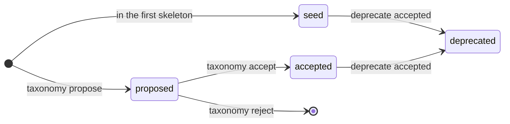
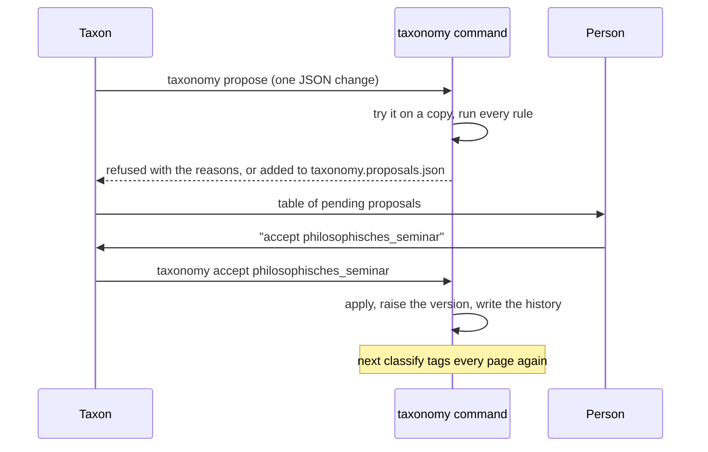

# Taxonomy management

This page explains how [`taxonomy.json`](../taxonomy.json) is built, which rules keep it sound and where those rules come from, how it changes over time, and how to read it or export it to other formats.

One command does all of this: `taxonomy`. It is the **gate** of the taxonomy: every read and every write goes through it, and nothing else edits the file. Taxon uses it through its `taxon-gate` skill ([`.claude/skills/taxon-gate/SKILL.md`](../.claude/skills/taxon-gate/SKILL.md)).

```bash
python -m uzh_crawler taxonomy tree --axis publics       # read
python -m uzh_crawler taxonomy check                     # verify every rule
python -m uzh_crawler taxonomy export --format ttl       # SKOS for other tools
```

## Three files

The taxonomy lives in three files at the root of the repository. The commands read and write them; a person reads them, and never edits them by hand.

| File | Holds | Changes when |
| --- | --- | --- |
| `taxonomy.json` | The taxonomy: four axes, their nodes, the version | A person accepts a proposal |
| `taxonomy.proposals.json` | Changes waiting for a decision | Taxon proposes, a person accepts or rejects |
| `taxonomy.history.jsonl` | One line per decision, accepted or rejected, with its date, version and reason | Each decision. Lines are only ever added |

All three are tracked by git. The two side files take their names from the taxonomy file: `--taxonomy other.json` works with `other.proposals.json` and `other.history.jsonl`.

## What a node is

A **node** is one concept of the taxonomy: a faculty, an audience, a kind of document. Classification tags each page with node ids, one or several per axis (see [Tags](tags.md)). Here is a node as `taxonomy.json` stores it:

```json
{
  "id": "mnf",
  "parent": "fakultaeten",
  "labels": {"de": "Mathematisch-naturwissenschaftliche Fakultät", "fr": "Faculté des sciences", "en": "Faculty of Science"},
  "alt_labels": {"de": ["MNF"]},
  "definition": {"de": "…", "fr": "…", "en": "…"},
  "status": "seed",
  "sources": ["https://www.mnf.uzh.ch/"]
}
```

The fields follow SKOS, the W3C standard for taxonomies and thesauri, so each one has a SKOS name in the Turtle export.

| Field | Meaning | Required | SKOS |
| --- | --- | --- | --- |
| `id` | The node's name for programs: permanent, never reused | yes | `skos:notation`, and the end of the URI |
| `parent` | The node just above, in the same axis; `null` at the top | yes | `skos:broader`, `skos:topConceptOf` |
| `labels` | The official name in German, French and English | yes | `skos:prefLabel` |
| `alt_labels` | Other names: abbreviations, older or informal names | no | `skos:altLabel` |
| `definition` | One sentence: what it is and where it sits | yes | `skos:definition` |
| `scope_note` | Where the line runs when two nodes could be confused | no | `skos:scopeNote` |
| `status` | Where the node stands, below | yes | `skos:editorialNote` |
| `sources` | Pages that show the node is real, usually the unit's home page | for new nodes | `dct:source` |
| `replaced_by` | For a retired node: the nodes to use instead | no | `dct:isReplacedBy` |

The top of the file carries `version`, `modified` (the date of the last accepted change) and `uri_base`, the start of every node's URI.

### The life of a node

A node is always in one status. The diagram reads from left to right: a node is born `seed` or `accepted`, and may later be retired.



| Status | Meaning | Offered to classification |
| --- | --- | --- |
| `seed` | From the protocol that started the taxonomy, not yet checked on a page | yes |
| `proposed` | Waiting in `taxonomy.proposals.json`; not in the taxonomy yet | no |
| `accepted` | Proposed from a crawl and accepted by a person | yes |
| `deprecated` | Retired. It stays in the file so that old tags keep their meaning | no |

A deprecated id is refused as a new tag. `validate` reports a page still tagged with it, with a message such as `organisation id is deprecated: fachbereich (replaced by departement); classify again`.

## The rules

A taxonomy is only useful while each node means one thing, sits in one place, and keeps its name. The rules below say how. Most come from three references, listed at the end of this page: the W3C SKOS Reference, the quality checks of qSKOS, and the ANSI/NISO Z39.19 standard for controlled vocabularies.

There are two kinds. **Checked rules** are verified by code on every `taxonomy check`, `propose` and `accept`. **Editorial rules** need judgement: Taxon applies them when it writes a proposal, and the person who decides checks them.

### Checked by the code

An `error` blocks the change. A `warning` is printed and does not.

| Rule | Level | What it requires | Source |
| --- | --- | --- | --- |
| `axes-required` | error | The four axes exist, each once | Contract of [Tags](tags.md) |
| `version-format` | error | `version` is `MAJOR.MINOR.PATCH` | Semantic versioning |
| `uri-base` | error | `uri_base` is an http(s) URI ending in `/` or `#` | SKOS: concepts are named by URIs |
| `fields-known` | error | A node has only the fields above; its texts only `de`, `fr`, `en` | Catches typos such as `defintion` |
| `id-format` | error | An id is lower case letters and digits joined by `_` | Stable, readable URIs |
| `id-unique` | error | An id appears once in the file and is not an axis id | SKOS: one URI, one concept |
| `parent-known` | error | A parent is a node of the same axis | One tree per axis |
| `hierarchy-cycle` | error | Following the parents never leads back to the node | qSKOS: cyclic hierarchical relations |
| `labels-complete` | error | A label in each language, not blank, no control characters | qSKOS: missing labels, incomplete language coverage |
| `definition-complete` | error | A definition in each language | qSKOS: undocumented concepts |
| `label-unique` | error | Two active nodes of an axis never share a label in one language | qSKOS: overlapping labels |
| `labels-disjoint` | error | An alternative label is not the node's own label, nor repeated | SKOS integrity condition S13 |
| `status-known` | error | The status is explained in `status_legend` | |
| `replacement-valid` | error | Only a retired node has `replaced_by`, naming active nodes of the same axis | Z39.19 §11.3.2.1 |
| `deprecated-parent` | error | An active node never hangs under a retired one | |
| `axis-active` | error | Every axis keeps at least one active node | Classification needs a choice |
| `alt-label-clash` | warning | An alternative label is not the label of another node of the axis | Z39.19 §5.3.1: ambiguity |
| `sources-present` | warning | An accepted node names a source page | Z39.19 §5.3.5: warrant |

For example, proposing to move `fakultaeten` under `mnf` is refused, because the two would be each other's parent:

```text
fakultaeten (move): error: hierarchy-cycle: fakultaeten: its parents lead back to it
fakultaeten (move): error: hierarchy-cycle: mnf: its parents lead back to it
propose: refused, nothing was written
```

### Editorial rules

1. **One node, one concept, one id for ever.** The id is never renamed and never given to another concept, even after the node is retired. A better name goes into `labels`; a wrong concept is retired and a new node is added.
2. **Warrant.** A node enters because pages need it, not because it might exist: several pages of a run fell back to a broader node (*literary warrant*), and the unit's own page shows its official name (*organizational warrant*) (Z39.19 §5.3.5).
3. **The parent passes the "all and some" test.** Every page about the child is, by definition, about the parent: every Philosophisches Seminar is part of the Philosophische Fakultät. All the children of one parent share the same relation to it, "is a kind of" or "is part of" (Z39.19 §8.3).
4. **Siblings do not overlap** on the two axes that take exactly one tag, `organisation` and `types_document`: a page must fit one sibling only. When two could be confused, a `scope_note` says where the line runs (Z39.19 §6.2.2).
5. **Labels are official names**, in each language as the unit's own pages give them. Abbreviations and other names go to `alt_labels`, so that `taxonomy find MNF` and `taxonomy hints` recognise them.
6. **A definition is one sentence** that says what the node is and where it sits, in the style of the existing nodes.
7. **Retire, never delete.** A node that is wrong, merged or split is deprecated, with the nodes that replace it in `replaced_by`. Old tags then still explain themselves (Z39.19 §11.3.2.1).
8. **Every change has a reason and a person decides.** A proposal says why, with example pages. Only a person accepts it, and only by naming its id (Z39.19 §11.3.1).
9. **Every decision is recorded**, accepted or rejected, with its date and reason. A rejected idea is recalled when it is proposed again (Z39.19 §11.3.2.2).
10. **Group changes.** Every accepted change makes the next `classify` tag every page again. Ten nodes accepted at once cost one reclassification, not ten.
11. **One parent per node.** The taxonomy has a single hierarchy per axis, so each node has one path from the top. SKOS allows several parents; this taxonomy deliberately does not.

## How a change travels

A change is first a **proposal**, then a **decision**. The diagram reads from top to bottom.



### The four kinds of change

Each proposal is one JSON object about one node. It has a `change`, a `reason`, optional `evidence` URLs, and the fields of its kind.

**Add** a node. The new id must never have existed. Its `sources` must name at least one page.

```json
{
  "change": "add",
  "axis": "organisation",
  "node": {
    "id": "philosophisches_seminar",
    "parent": "philosophische",
    "labels": {"de": "Philosophisches Seminar", "fr": "Séminaire de philosophie", "en": "Department of Philosophy"},
    "definition": {"de": "…", "fr": "…", "en": "…"},
    "sources": ["https://www.philosophie.uzh.ch/"]
  },
  "reason": "34 pages of runs/phil fell back to philosophische",
  "evidence": ["https://www.philosophie.uzh.ch/de/studium.html"]
}
```

**Update** the texts of a node: `labels`, `alt_labels`, `definition`, `scope_note` or `sources`. Only the languages given change; the others stay. An empty value removes that language.

```json
{"change": "update", "id": "mnf", "set": {"alt_labels": {"de": ["MNF"]}}, "reason": "Pages and summaries call the faculty MNF"}
```

**Move** a node under another parent of the same axis, or to the top with `"parent": null`. Its children move with it.

```json
{"change": "move", "id": "dsi", "parent": "services_centraux", "reason": "…"}
```

**Deprecate** a node. It stays in the file, leaves classification, and points to its successors. Its children must be moved first: a proposal that moves them can come earlier in the same batch.

```json
{"change": "deprecate", "id": "fachbereich", "replaced_by": ["departement"], "reason": "Fachbereich and Departement name the same kind of unit on UZH pages"}
```

### What each step does

- **`taxonomy propose [FILE]`** reads one change, or a list of them, from a file or from standard input. It tries each on a copy of the taxonomy with the pending proposals already applied, and runs every checked rule. Only the problems that the new change brings count against it. If any change is refused, nothing is written. There is one pending proposal per node at a time.
- **`taxonomy pending`** lists what waits for a decision.
- **`taxonomy accept ID…`** applies the proposals for those ids, in the order of the file. Either all of them pass the rules again and are written, or none is. It raises the version, sets `modified`, removes them from the pending file and writes one history line each. A child can be accepted only with its parent, or after it.
- **`taxonomy reject ID… --reason TEXT`** removes proposals and keeps the reason in the history. The taxonomy and its version do not change.

```text
$ python -m uzh_crawler taxonomy accept philosophisches_seminar fachbereich mnf
accepted: philosophisches_seminar (add)
accepted: fachbereich (deprecate)
accepted: mnf (update)
version: 1.0.0 -> 2.0.0
taxonomy.json changed: the next classify tags every page again (summaries are kept).
```

## Versions

The version follows semantic versioning: `MAJOR.MINOR.PATCH`. Which part rises depends on what the change can do to existing tags. A batch raises the highest part among its changes.

| Change | Part | Why |
| --- | --- | --- |
| `deprecate` | major, `1.4.2 → 2.0.0` | An id that was valid is no longer offered: existing tags must be redone |
| `add`, `move` | minor, `1.4.2 → 1.5.0` | Every existing tag stays valid; the tree gains a node or a new shape |
| `update` | patch, `1.4.2 → 1.4.3` | Only texts change |

Whatever the part, any accepted change alters the bytes of `taxonomy.json`. Classification keys its cache on those bytes, so the next `classify` tags every page again ([Resume and cache](resume-and-cache.md)).

## History

`taxonomy.history.jsonl` has one JSON object per line. Lines are only ever added; git shows who added each one. Accepting the `add` above, for example, writes:

```json
{"version": "1.1.0", "date": "2026-12-02", "change": "add", "id": "philosophisches_seminar", "axis": "organisation", "after": {"id": "philosophisches_seminar", "…": "…"}, "reason": "34 pages of runs/phil fell back to philosophische", "evidence": ["https://www.philosophie.uzh.ch/de/studium.html"]}
```

An `update`, `move` or `deprecate` line also has `before`, so a change can be understood, and undone by a new proposal, without reading git. A `reject` line keeps the whole proposal. The first line, `init`, marks version 1.0.0.

`taxonomy history` prints the lines, and `taxonomy history mnf` those of one node. After the `update` of `mnf` shown above, the whole history reads:

```text
1.0.0  2026-11-27  init       -: Version numbering starts: 66 seed nodes in 4 axes, taken from the uzh-metadata-explorer protocol.
1.0.1  2026-12-02  update     mnf: Pages and summaries call the faculty MNF
```

## Reading the taxonomy

The reading commands answer in plain text for a person; `--json` gives the same content to a program or a model.

| Command | Answers | Options |
| --- | --- | --- |
| `taxonomy tree` | The tree of each axis, with each node's status | `--axis`, `--lang`, `--deprecated` |
| `taxonomy show ID` | Everything about one node: path from the top, children, labels, definition, sources, history, a pending proposal | |
| `taxonomy find WORD…` | Nodes whose id or labels hold the words | `--lang` |
| `taxonomy pending` | Proposals waiting for a decision | |
| `taxonomy history [ID]` | Decisions, of one node or of all | |

```text
$ python -m uzh_crawler taxonomy tree --axis publics
Taxonomie du web UZH — version 1.0.0

publics — Publics (10 active, 0 deprecated)
  studierende — Étudiants [seed]
    studierende_bachelor — Étudiants bachelor [seed]
    studierende_master — Étudiants master [seed]
  doktorierende — Doctorants [seed]
  …
```

`find` ignores case, accents and punctuation, so `Universitat Zurich` finds `Universität Zürich`. It ranks the matches: the whole label first, then every word inside the id or a label, then inside the definition, and last a word that shares its first six letters with a label word, so that `philosophie` finds `Philosophische Fakultät`.

```text
$ python -m uzh_crawler taxonomy find MNF
mnf  organisation  Faculté des sciences  [seed]  (id)
```

`taxonomy check` verifies every checked rule on the taxonomy, then on the pending proposals. It ends with a summary:

```text
taxonomy: ok — version 1.0.0, 66 nodes (66 seed), 0 pending, 0 errors, 0 warnings
```

## Exports

An export is computed from `taxonomy.json` and its history. It is printed on standard output, or written to the file given with `--output`. Nodes come in tree order, axis by axis.

| Command | Gives | For |
| --- | --- | --- |
| `taxonomy export --format csv` | One row per node: axis, id, URI, parent, path, depth, status, labels, alternative labels, definitions and scope notes in three languages, sources, replacements | A spreadsheet |
| `taxonomy export --format json` | Each axis with its nodes, each node with its URI, path and children, then the history | Another program |
| `taxonomy export --format md` | A document: a nested list per axis, retired nodes, statuses, history. In the language of `--lang` | A person |
| `taxonomy export --format ttl` | SKOS in Turtle: each axis a `skos:ConceptScheme`, each node a `skos:Concept` | Taxonomy and linked-data tools (Skosmos, VocBench, qSKOS) |

```bash
python -m uzh_crawler taxonomy export --format md --lang de --output taxonomie.md
python -m uzh_crawler taxonomy export --format ttl --output taxonomy.ttl
```

In CSV, lists are joined with ` | ` and the path with ` > `. The file is UTF-8 with a header row.

In Turtle, a node reads like this:

```turtle
tx:fachbereich a skos:Concept ;
    skos:inScheme tx:organisation ;
    skos:notation "fachbereich" ;
    skos:prefLabel "Fachbereich"@de, "Domaine"@fr, "Subject area"@en ;
    skos:definition "…"@de, "…"@fr, "…"@en ;
    skos:changeNote "2.0.0 (2026-11-27) deprecate: Fachbereich and Departement name the same kind of unit on UZH pages."@en ;
    owl:deprecated true ;
    dct:isReplacedBy tx:departement .
```

A retired node stays a concept, marked `owl:deprecated`, with `dct:isReplacedBy`, and leaves the hierarchy: no `skos:broader`, `skos:narrower` or top concept. Every `skos:broader` has its `skos:narrower` in the other direction. The test suite parses the export with `rdflib`, installed by `pip install -e ".[dev]"`, and checks both.

A node's URI is `uri_base` followed by its id: today `https://github.com/alogean/uzh_data_crawler/blob/taxonomie-uzh/taxonomy.json#mnf`. The base can be changed until the URIs are used outside this repository; after that it stays, like the ids.

## Hints from a run

`taxonomy hints --out RUN` starts most `add` proposals. When no `organisation` node names the unit that publishes a page, classification tags a broader node and writes the unit's name in the page's `missing_unit`. The command groups those names and prints JSON, for example:

```json
[
  {
    "unit": "Philosophisches Seminar",
    "pages": 34,
    "tagged_as": {"philosophische": 30, "institut": 4},
    "hosts": {"www.philosophie.uzh.ch": 34},
    "examples": ["https://www.philosophie.uzh.ch/de/studium.html"],
    "matches": []
  }
]
```

`matches` lists the nodes whose label or alternative label is that very name. A match means the node exists and classification missed it: an `update` with a new alternative label, not an `add`.

## Exit codes

| Code | Meaning |
| --- | --- |
| `0` | Done. For `check`: no error, warnings may be printed |
| `1` | A file is missing or unreadable, an id is unknown, or no proposal is pending for it |
| `2` | Refused: `check` found an error, `propose` or `accept` broke a rule, or `find` found nothing |

## Keeping this page current

The test file [`tests/test_gate_docs.py`](../tests/test_gate_docs.py) fails when a command, a checked rule, an export format or a kind of change exists in the code without being named on this page and in the `taxon-gate` skill. It checks names, not meanings: whoever changes the behaviour also rewrites the sentences that describe it.

The code is in [`src/uzh_crawler/gate/`](../src/uzh_crawler/gate/): `store.py` (files, versions), `checks.py` (the checked rules), `changes.py` (proposals, accept, reject), `read.py`, `export.py`, `hints.py`, and `commands.py` for the command line.

## Sources

- W3C, [SKOS Simple Knowledge Organization System Reference](https://www.w3.org/TR/skos-reference/) (2009): the data model, the integrity conditions (S13, S14, S27), the documentation properties.
- C. Mader, [qSKOS quality issues](https://github.com/cmader/qSKOS/wiki/Quality-Issues), and C. Mader, B. Haslhofer, A. Isaac, [Finding Quality Issues in SKOS Vocabularies](https://arxiv.org/abs/1206.1339) (2012): the catalogue of structural and labelling problems.
- NISO, [ANSI/NISO Z39.19-2005 (R2010), Guidelines for the Construction, Format, and Management of Monolingual Controlled Vocabularies](https://groups.niso.org/higherlogic/ws/public/download/6484/): warrant (§5.3.5), scope and history notes (§6.2), hierarchical relationships and the all-and-some test (§8.3), maintenance, deletion and history of changes (§11.3).
- J. Neubert, [proposal for deprecating concepts in SKOS](https://lists.w3.org/Archives/Public/public-lod/2010Mar/0271.html) (2010): `owl:deprecated` with `dct:isReplacedBy`, version information on the scheme rather than on each concept.
- [Semantic Versioning 2.0.0](https://semver.org/).
